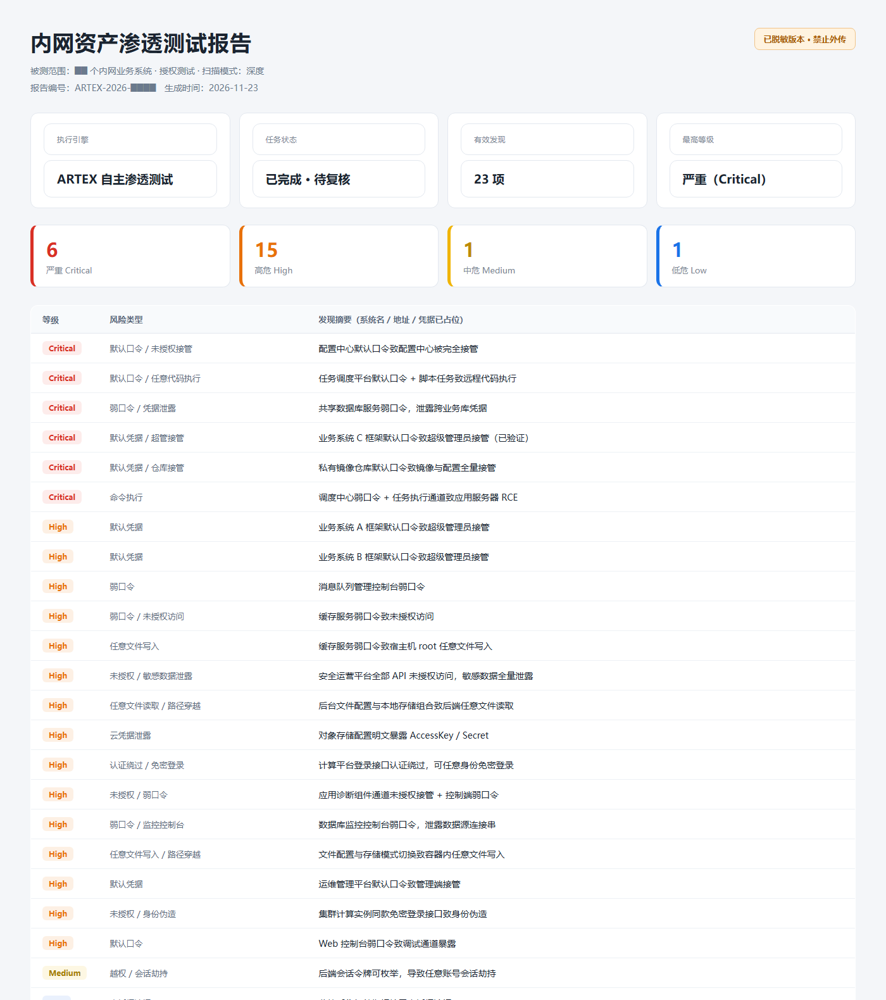

# ARTEX 部署（Docker Compose）



> 上图：ARTEX 输出的渗透测试报告脱敏样例，系统名 / IP / 口令均已占位。

内网服务器部署记录：`ruoji6/artex:latest`（v0.3.30）+ `postgres:16-alpine`。

## 目录说明

| 路径 | 说明 |
| --- | --- |
| `docker-compose.yml` | 服务编排（artex + postgres） |
| `.env.example` | 配置模板，复制为 `.env` 使用 |
| `skills/` | 挂载到容器 `/app/skills` |
| `data/` | 运行时数据（jwt.key、sqlite），**未纳入版本库** |
| `config.example.json` | 单二进制运行时的配置样例 |

## 部署步骤

```bash
cp .env.example .env      # 填 POSTGRES_PASSWORD、OPENAI_API_KEY 等
docker compose up -d
```

访问 `http://<服务器IP>:8787`，首次进 `/setup` 设置管理员密码。

## 服务

- `artex-artex-1`：应用，监听 8787；8788 为流量录制代理，仅绑定 127.0.0.1
- `artex-postgres-1`：PostgreSQL 16，数据卷 `artex_pgdata`
- 健康检查：`GET /api/health` → `{"ok":true}`

## 常用命令

```bash
docker compose ps
docker compose logs -f artex
docker compose down
docker compose pull && docker compose up -d artex   # 更新镜像
```

## 注意

- `POSTGRES_PASSWORD` 不要含 `#` `!` 等特殊字符：它会被拼进 DSN，未编码会导致启动失败。
- `data/` 与 `.env` 含敏感信息，已加入 `.gitignore`，请勿提交。

## 备份与报告样例

- `secure/` — 加密备份（运行时配置与数据、扫描任务产物分片），解密方法见 `secure/README.md`。
- `reports/report_redacted.png` — 渗透测试报告脱敏样例图（系统名 / IP / 口令均已占位）。

> 说明：`.env.example` 中的 `ARTEX_LLM_BASE_URL` 为占位地址，请替换为你自己的 OpenAI 兼容网关。

## 配置大模型（添加 LLM）

ARTEX 需要一个大模型来驱动 Agent 与报告生成。两种方式任选其一。

### 方式 A：环境变量（启动时注入，最简单）

编辑 `.env`：

```bash
ARTEX_LLM_PROVIDER=openai                                          # 提供方类型
ARTEX_LLM_MODEL=glm-5.3                                            # 模型名，必须是你的 Key 有权限的
ARTEX_LLM_BASE_URL=https://your-llm-gateway.example.com/v1          # OpenAI 兼容网关地址
OPENAI_API_KEY=<你的 API Key>
```

```bash
docker compose up -d artex
docker compose logs artex | grep "LLM configured"   # 期望：LLM configured from env: openai / <模型名>
```

### 方式 B：Web 界面新增模型配置（可多套、可切换）

1. 浏览器打开 `http://<服务器IP>:8787`，用管理员登录（首次访问走 `/setup` 设置密码）。
2. 左侧 **系统 → LLM**，点 **新建模型配置**。
3. 按下表填写：

| 字段 | 填什么 | 说明 |
| --- | --- | --- |
| 名称 | 自定义，如「安全渗透测试」 | 仅用于区分 |
| 格式 / Format | **OpenAI (Chat Completions)** | 只支持 `anthropic`、`openai`、`openai-responses`、`jev` 四种，通用网关一律选 `openai` |
| 模型 / Model | 如 `glm-5.3` | 必须是该 Key 已授权的模型，否则调用返回 401 |
| Base URL | `https://your-llm-gateway.example.com/v1` | 需带 `/v1`；本地 Ollama 可填 `http://host:11434/v1` |
| API Key | 你的 Key | 存在 `llm_profiles` 表里，不再走环境变量 |
| 设为默认 / is_default | 勾选 | 多套配置时决定当前生效的那套 |
| 流式 / streaming | 勾选 | 关闭后部分网关兼容性更好 |

4. 保存后在 **LLM** 页面点一次 **测试/握手**，或用任意任务跑一轮确认。

### 校验与排错

```bash
docker compose logs artex | grep -E "built provider|LLM reapplied|401"
```

- `built provider for LLM profile 1` + `LLM reapplied from active profile`：UI 配置已生效。
- `401 INVALID_API_KEY`：Key 无效或**该 Key 没有所填模型的权限**（换成有权限的模型再试）。
- `LLM CONNECTION FAILED`：Base URL/网络不通，先在容器内验证：
  `docker exec artex-artex-1 curl -sS -H "Authorization: Bearer $OPENAI_API_KEY" <BASE_URL>/models`
- 改了 `.env` 必须 `docker compose up -d artex` 重建容器才生效；改了 UI 配置即时生效，无需重启。
